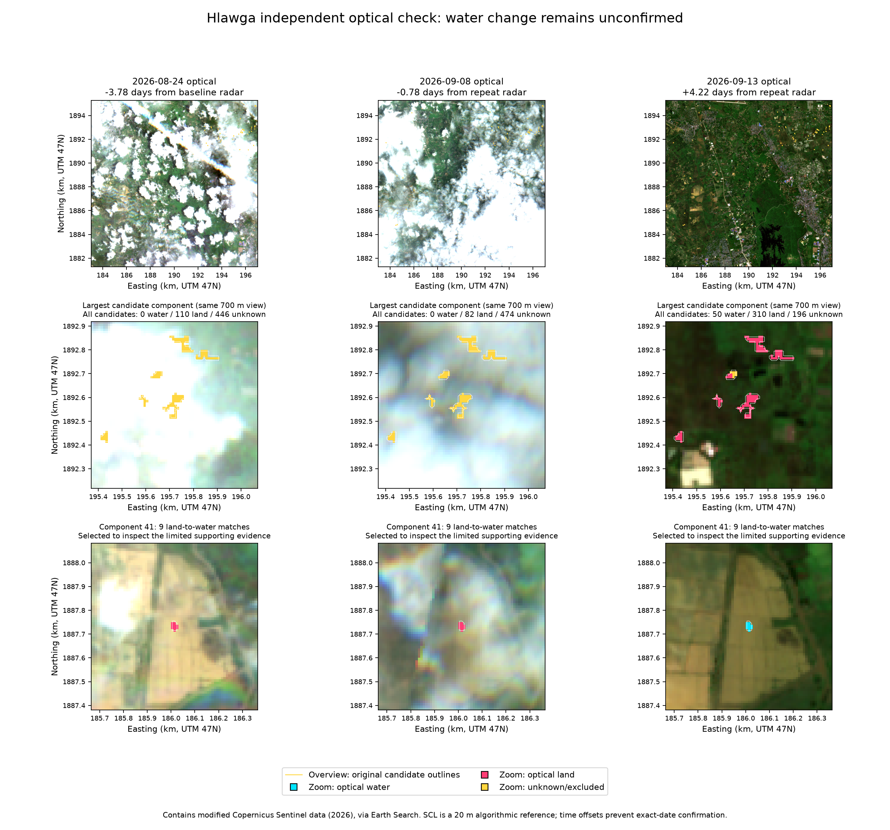

# Independent optical check: Hlawga study area

**Outcome: check completed; the NISAR water-change interpretation remains unconfirmed.**

The original 556-cell candidate mask (0.0556 km², displayed as 0.056 km²) was compared with independent Copernicus Sentinel-2 Level-2A scene classification (SCL) and dated true-color imagery. No candidate cells have usable optical coverage at both ends within three days of the radar acquisitions. An exploratory seven-day window yields 9 land-to-water matches, 101 land-to-land disagreements, and 446 unknown cells. These are observations at different times, not a flood accuracy score.

This audit tests the existing result without changing its threshold, candidate mask, reported area, or heuristic score. It does not establish the cause of the separate 4.517 km² apparent water loss.

## Evidence and acquisition timing

Radar baseline: **2026-08-27 23:02:39 UTC**. Radar repeat: **2026-09-08 23:02:39 UTC**.

The Earth Search query covers August 20 through September 16, 2026 and the complete study-area bounding box. It returned 14 items across seven acquisition dates. Tile **46QHD** covers the full study area; neighboring 46QHE covers its northern edge and is not counted as another observation of the same pass. All seven full-coverage scenes were screened. Selection ranks usable coverage over the candidate mask, then absolute time offset, without considering agreement with the radar classification. The time windows are analyst choices, not a preregistered protocol.

| Optical acquisition (UTC) | From radar baseline (days) | From radar repeat (days) | Usable candidate cells / 556 | Water / land / unknown cells |
| ------------------------- | -------------------------: | -----------------------: | ---------------------------: | ---------------------------: |
| Aug 24, 04:13:45          |                     −3.784 |                  −15.784 |                          110 |                0 / 110 / 446 |
| Aug 26, 04:14:03          |                     −1.784 |                  −13.784 |                            0 |                  0 / 0 / 556 |
| Aug 29, 04:13:45          |                     +1.216 |                  −10.784 |                            0 |                  0 / 0 / 556 |
| Sep 3, 04:13:46           |                     +6.216 |                   −5.784 |                           58 |                 0 / 58 / 498 |
| Sep 8, 04:13:45           |                    +11.216 |                   −0.784 |                           82 |                 0 / 82 / 474 |
| Sep 13, 04:13:46          |                    +16.216 |                   +4.216 |                          360 |               50 / 310 / 196 |
| Sep 15, 04:14:01          |                    +18.216 |                   +6.216 |                            0 |                  0 / 0 / 556 |

Counts include the cloud/shadow exclusion buffer described below. Scene-wide cloud percentages were not used as a substitute for local coverage. The September 13 scene is mostly clear across the study area, but only 360/556 candidate cells meet the conservative quality rule.

## Agreement, disagreement, and missing evidence

**Primary window: ±3 days.** Both August 26 and August 29 have zero usable candidate cells near the radar baseline. September 8 provides 82 land-classified cells but was acquired **18 hours 48 minutes 54 seconds before** the repeat radar observation. Thus paired coverage is **0/556**. No close-date land-to-water assessment is possible. Zero assessable cells does not mean zero change.

**Exploratory window: ±7 days.** The selected pair is August 24 and September 13: **3.784 days before** the baseline radar and **4.216 days after** the repeat radar. The optical pair spans approximately 20 days, versus the radar pair's 12 days.

| Reference transition           | Radar-grid cells | Grid area (km²) | Interpretation                                                       |
| ------------------------------ | ---------------: | --------------: | -------------------------------------------------------------------- |
| Land → water                   |                9 |          0.0009 | Limited agreement with the candidate hypothesis at the optical dates |
| Land → land                    |              101 |          0.0101 | Does not support persistent new water between the optical dates      |
| Water → water                  |                0 |               0 | None among jointly assessable candidates                             |
| Water → land                   |                0 |               0 | None among jointly assessable candidates                             |
| Unknown at either optical date |              446 |          0.0446 | Excluded; never interpreted as land or agreement                     |
| Total                          |              556 |          0.0556 | Original candidate footprint                                         |

Only **19.8%** of the candidate footprint is jointly assessable. Land-to-water matches account for **8.2% of that assessable subset**, or **1.6% of the entire candidate footprint**. These fractions must not be called flood precision or overall map accuracy. Clouds produce a nonrandom sample, the reference is itself an algorithm, and the acquisition intervals differ. Recall and specificity were not measured because noncandidate areas were not assessed as a validation sample.

All nine matches lie in one connected component, **component 41**, centered near **17.052476° N, 96.050466° E**. Its location is west of the main reservoir visible in the true-color overview. The zoom shows a field-shaped setting; that visual interpretation does not establish a crop type, water depth, flood cause, or reservoir shoreline movement. The same component is land-classified in the September 8 optical scene, which precedes the radar acquisition. Treat it as a location for follow-up, not a confirmed flood polygon.

The 101 land-to-land cells disagree with a persistent optical water-gain interpretation. They are not proven radar false positives: transient change between acquisitions, mixed pixels, classification errors, and registration differences remain possible. The 446 unknown cells cannot be extrapolated from the clear subset.

## Inspect the original polygons on optical imagery



The overview draws the original candidate GeoJSON contours. The middle row uses the largest raster component to choose a 700 m inspection window independently of agreement. The last row deliberately shows component 41 to inspect the limited supporting evidence. Its selection is disclosed; it is not representative of all candidates. Cyan denotes usable optical water, pink usable optical land, and yellow excluded/unknown cells. The true-color images provide visual context; quantitative labels come from SCL, not manual visual ground truth.

## Method and limits

1. Preserve the original candidate mask and GeoJSON hashes. Read only small, georeferenced Sentinel-2 SCL and true-color crops from public cloud-optimized GeoTIFFs. Retain source URLs, complete catalog items, timestamps, and crop hashes.
2. Accept SCL vegetation (4), nonvegetated land (5), and water (6). Treat nodata, defective cells, cast/cloud shadows, unclassified, clouds, cirrus, and snow/ice as unknown. Exclude one native 20 m pixel around these classes using four-connected neighbors. This is a conservative screening rule, not a guarantee that every remaining cell is clear.
3. Reproject from the Sentinel-2 tile's EPSG:32646 grid to the original NISAR EPSG:32647 grid with nearest-neighbor resampling for categorical layers. The 1400 × 1400 target has 10 m spacing and upper-left pixel edge at easting 183020 m, northing 1895280 m. Stored radar image corners are pixel centers; apply the half-pixel offset when constructing the affine transform. True color uses bilinear display resampling only.
4. Count transitions only where both references are usable. Quantitative areas use the **original raster mask**, not the visualization polygons: their contours round coordinates to pixel centers and do not exactly reproduce pixel area. A table of all 46 four-connected candidate components is included in the JSON.
5. Translate both optical reference grids together by −10, 0, and +10 m along each grid axis as a registration sensitivity diagnostic. Jointly usable counts range from **104 to 116**; land-to-water matches remain **9**, and land-to-land counts range from **95 to 107**. This is not surveyed registration accuracy or a confidence interval, and it does not test relative misregistration between the two optical dates.

**Spatial and temporal limits:** resampling 20 m SCL onto a 10 m grid does not create independent 10 m observations. The nine matching radar cells are not nine independent optical measurements. No field survey, reservoir operating record, manual reference delineation, or surveyed registration control was available for this audit. Different dates cannot establish the exact timing or cause of change. The optical algorithm can misclassify water, vegetation, shadow, and mixed pixels. Do not relabel the 0.056 km² candidate as validated flooding or convert the heuristic 0.639 score into a probability.

## Reproduce and inspect

### Interactive evidence explorer

The app's **Optical Evidence** mode compares a selected NISAR HH observation against one of the three cached true-color scenes (August 24, September 8, September 13). The labels show the date and signed timing relationship. Optical selection does not change the underlying radar classification or the audit's selected exploratory pair.

Click a candidate marker, or use the candidate selector in **Explore candidate evidence**. Each entry shows its original raster area, both radar acquisition times, per-scene optical water/land/unknown counts, and the exploratory pair's transitions. The same selection is outlined on both halves of the map. Markers locate small candidates and do not represent their area.

For selectable boundaries, `scripts/build_optical_explorer.py` reconstructs exact pixel-edge polygons from the archived mask instead of attaching counts to the older rounded visualization contours. All 46 component IDs match `comparison.json`. A round-trip rasterization test checks that these selectable polygons recover every original labeled candidate cell. Radar and optical previews use the same pixel-edge corners in this view. This is a display alignment, not a new surveyed registration result.

To rebuild the three web previews and `map-evidence.json` using the cached imagery:

```sh
python scripts/build_optical_explorer.py
python -m pytest tests/test_optical_explorer.py -q -p no:cacheprovider
```

The exported `map-evidence.json` includes the footprints, component evidence, optical asset links, image corners, and archived mask hash. No network access is needed for this build. The imagery remains unchanged by the optical quality exclusions; exclusions apply to the reference counts. Clouds therefore remain visible in the true-color views.

### Reproduce the underlying optical audit

From the repository root, with Python and the optional audit dependencies:

```sh
python -m pip install -r scripts/requirements-validation.txt
python -u scripts/validate_hlawga_optical.py --figures
python -m pytest tests/test_optical_validation.py -q -p no:cacheprovider
```

The script reuses cached optical crops. If absent, it downloads only the relevant windows from public assets. It uses the original `data/processed/yangon-track40-frame10/change_mask.npy` when present; otherwise it reads the losslessly archived `candidate-mask.npy.gz`. Raw NISAR HDF5 products are not needed to reproduce this comparison. The original detection pipeline is documented separately in [real-data-validation.md](real-data-validation.md).

Artifacts in [data/validation/yangon-track40-frame10](../../data/validation/yangon-track40-frame10/):

- [comparison.json](../../data/validation/yangon-track40-frame10/comparison.json): results, time offsets, per-component counts, registration diagnostic, processing snapshot, and source-mask/geometry hashes.
- [scene-audit.json](../../data/validation/yangon-track40-frame10/scene-audit.json): all seven scenes, quality exclusions, and alignment grid.
- `earth-search-sentinel2-initial.json` and `earth-search-sentinel2-next.json`: saved catalog query/results and empty pagination check.
- `crops/`: native optical GeoTIFF crops and aligned categorical caches.
- `visual-assets.json`: original true-color asset URLs and crop hashes.
- `candidate-mask.npy.gz`: exact archived NISAR candidate input.
- [optical-comparison.png](../../data/validation/yangon-track40-frame10/optical-comparison.png): inspectable dated overlays.

## Sources and attribution

- [Copernicus Sentinel-2 processing documentation](https://sentiwiki.copernicus.eu/web/s2-processing): SCL definitions and processing context. SCL is an algorithmic scene classification, not surveyed ground truth.
- [Element 84 Earth Search](https://github.com/Element84/earth-search/blob/main/README.md): public STAC discovery and hosted Sentinel-2 cloud-optimized assets. Full item provenance is retained with the audit.
- [Rasterio windowed reading](https://rasterio.readthedocs.io/en/stable/topics/windowed-rw.html): georeferenced crop access.
- Contains modified Copernicus Sentinel data (2026), accessed through Earth Search. Radar data: NASA/ISRO NISAR via ASF DAAC. Analysis and interpretation: Team YOUTHs.

**Suggested presentation wording:** “We independently checked our radar candidates against dated Sentinel-2 observations. Clouds prevented a close-date paired comparison. A wider-date check found nine land-to-water reference matches, 101 land-to-land disagreements, and 446 unassessable cells. We therefore keep the water-change interpretation unconfirmed and publish the evidence for review.”
